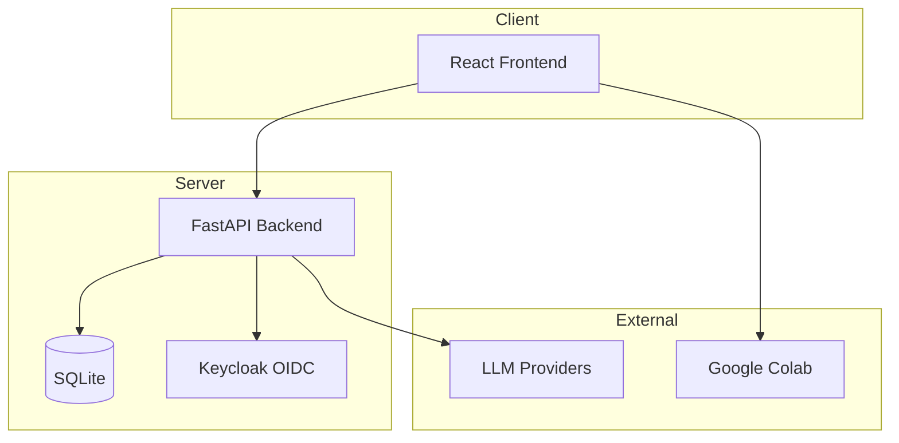

# Nexus Pilot LLM Course Platform

> Work in progress. This checkpoint may be incomplete or fail tests. See PLAN.md and STATUS.md before use.


**Alan Vo | AI & Machine Learning**

A structured course platform for learning Large Language Models (LLMs) with interactive roadmaps, Colab notebooks, and hands-on fine-tuning workflow guides.

## Problem

Developers entering the LLM space face fragmented resources, outdated Colab notebooks, and unclear paths from basics to production fine-tuning. Common failure points include Axolotl configuration errors, quantization failures (GGUF), dependency conflicts, and broken reference links.

## Approach

This platform provides:
- **Curated roadmaps** with validated progression from LLM fundamentals to advanced fine-tuning
- **Working Colab notebooks** with tested configurations and troubleshooting guides
- **Fine-tuning workflows** for Axolotl, DPO/RLHF, quantization (GGUF), and function calling
- **AI-assisted explanations** grounded in actual course content (opt-in, advisory only)

## Quick Start

### Prerequisites
- Docker and Docker Compose
- Node 24+ and Python 3.12+ (for local development)

### With Docker Compose
```bash
cp .env.example .env
# Edit .env with your settings
docker compose up -d
```
- Frontend: http://localhost:5173
- Backend API: http://localhost:8000
- Keycloak: http://localhost:8080 (admin/admin)

### Local Development

**Backend:**
```bash
cd backend
python -m venv .venv
.venv/bin/pip install -r requirements.txt
.venv/bin/uvicorn app.main:app --reload
```

**Frontend:**
```bash
cd frontend
npm install
npm run dev
```

## Testing

```bash
# Backend tests
cd backend
.venv/bin/python -m pytest

# Frontend tests
cd frontend
npm test
```

## Architecture



## API Endpoints

| Method | Path | Description |
|--------|------|-------------|
| GET | /api/health | Health check |

## Configuration

| Variable | Description | Default |
|----------|-------------|---------|
| LLM_API_KEY | API key for LLM provider | (required for AI features) |
| LLM_PROVIDER | Provider type (openai-compatible, anthropic, gemini, ollama) | openai-compatible |
| LLM_MODEL | Model name | gpt-4o-mini |
| LLM_BASE_URL | Provider base URL | https://api.openai.com/v1 |
| KEYCLOAK_URL | Keycloak server URL | http://localhost:8080 |
| KEYCLOAK_REALM | Keycloak realm | nexus-pilot |
| DATABASE_URL | Database connection string | sqlite:///./nexus_pilot.db |

## Security Limitations

- Demo mode binds to localhost only; refuses to start in production without explicit configuration
- No hardcoded secrets; all credentials via environment variables
- OIDC tokens validated with signature/issuer/audience checks
- HttpOnly SameSite cookies for session management
- LLM keys never exposed to frontend

## AI/ML Evaluation

This platform focuses on **reproducible fine-tuning workflows**. Evaluation approach:

- **Baseline**: Reference configurations from mlabonne/llm-course
- **Metrics**: Training loss convergence, quantization success rate, inference latency
- **Data**: Small labeled datasets for function calling (e.g., 100 examples)
- **Reproducible command**: `docker compose up` + run notebooks in Colab

**Known failure cases** (from upstream issues):
- Axolotl merge operation missing from notebooks (Issue #40)
- GGUF quantization tokenizer.model not found (Issue #8)
- Dependency conflicts: numpy/protobuf/torch versions (Issue #64)
- RunPod template ID outdated (Issue #55)
- Incorrect DPO reference link for Mistral-7b (Issue #79)
- Unnecessary ref_model in LoRA DPO (Issue #44)

## SSO/SAML Setup

Keycloak supports SAML identity providers through identity brokering:
1. Configure SAML IdP in Keycloak Admin Console → Identity Providers → SAML v2.0
2. Map SAML attributes to Keycloak roles (viewer/operator/admin)
3. Test brokered login flow

## License

MIT License - Copyright (c) 2026 Alan Vo <alanvo@gmail.com>